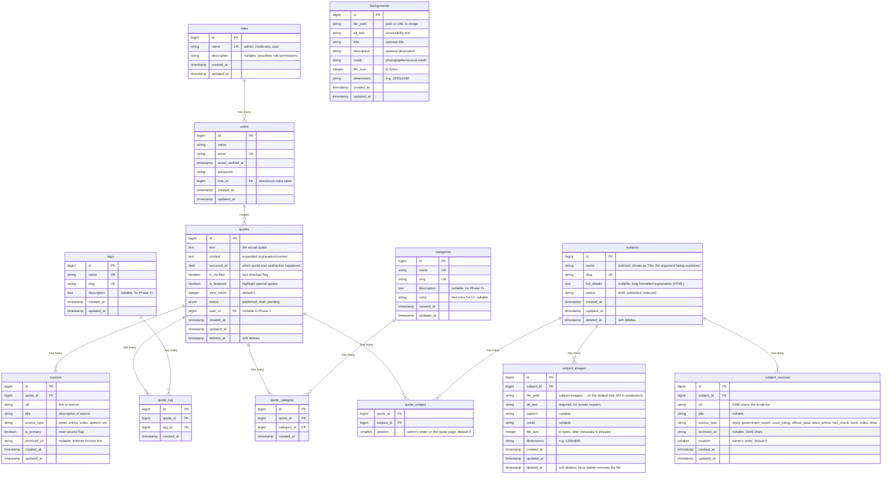

# Database ERD - Whimsical Trump Quotes

This file contains the Mermaid syntax for the database Entity Relationship Diagram.
You can paste this into https://mermaid.live/ to view or export as PNG/SVG.

## Tables Summary

### Core Tables

- **roles**: User role definitions (admin, moderator, user)
- **users**: All users (admin and regular users in Phase 3+)
- **quotes**: The main content - Trump quotes/actions
- **sources**: Multiple sources per quote (URLs, citations)
- **backgrounds**: Whimsical background images (separate pool)
- **tags**: Many-to-many tagging system
- **categories**: Many-to-many categorization system
- **subjects**: Reusable explanations (full details) shared by quotes that make the same argument
- **subject_images**: Images uploaded from the full details editor; the subject's HTML refers to them by URL
- **subject_sources**: The evidence behind a subject's full details (studies, reports, rulings), in order

### Pivot Tables

- **quote_tag**: Links quotes to tags
- **quote_category**: Links quotes to categories
- **quote_subject**: Links quotes to subjects, with a `position` for ordering (unique on quote_id + subject_id, no timestamps)

## Key Relationships

- One role has many users
- One user creates many quotes
- One quote has many sources
- Quotes and backgrounds are separate pools (no direct relationship - randomly paired)
- Quotes have many tags (via quote_tag pivot)
- Quotes have many categories (via quote_category pivot)
- Quotes have many subjects, in order (via quote_subject pivot); a subject can be shared by many quotes

## Notes

- Using BIGINT auto-incrementing IDs (Laravel default)
- Soft deletes on quotes and subjects tables (deleted_at)
- Status enum for quotes: published, draft, pending
- user_id is nullable in Phase 1 (admin-created quotes don't need user attribution initially)
